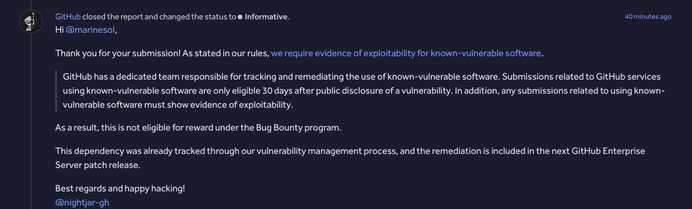
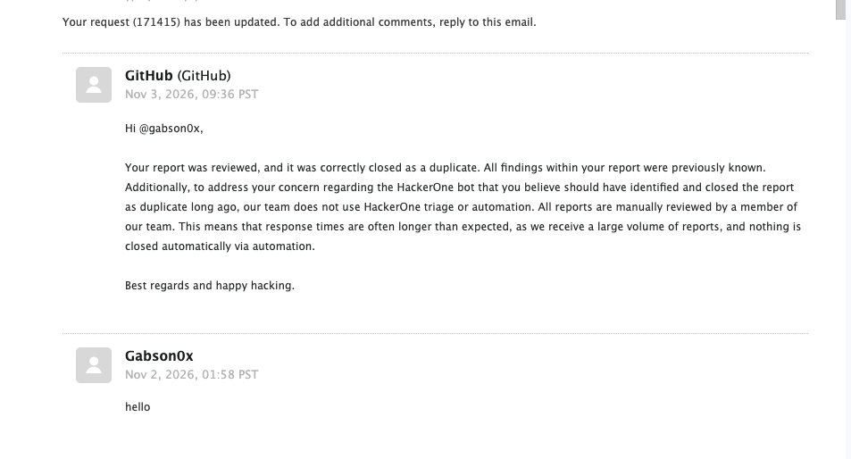
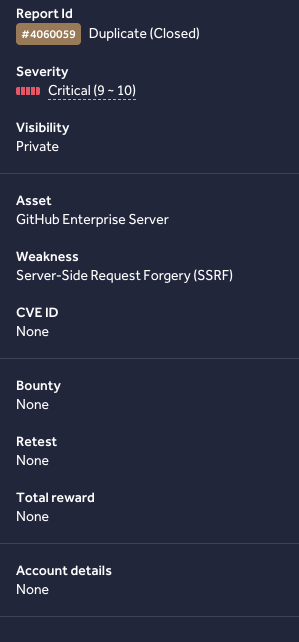
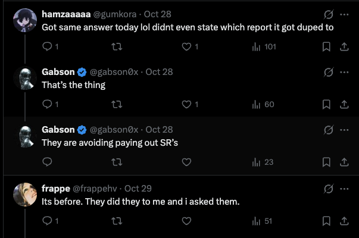

# GitHub Wall of Shame

**By [@gabson0x](https://github.com/Gabson0x) — how GitHub's bug bounty paid me
$0 on a CVE-linked High and a Critical SSRF after I burned ~7 hours of my own
AWS money building the lab.**

I'm not writing this to "start a debate about responsible disclosure." I'm
writing it because **GitHub Security closed both of my reports with form
answers, kept the severities (and the CVE), never showed the "duplicate" they
cited, and support's explanation contradicted the platform.** Other researchers
are getting the same script. Screenshots below.

---

## My two reports — what I filed vs what I got

| | What I proved | What GitHub told me | What I was paid |
|---|---|---|---|
| [#4060097](https://hackerone.com/reports/4060097) · High **7.7** | GHES avatar upload → `libheif` `iinf` flood pins the main worker pool ~30 s/file; concurrency = web-tier DoS. Any authed user. H1 lists **CVE-2026-19118** on *my* report — the **only** report linked to that CVE. | Triaged **high**, then flipped to **ineligible / Informative**: "known-vulnerable software," 30-day rule, "must show evidence of exploitability." | **$0** |
| [#4060059](https://hackerone.com/reports/4060059) · Critical **9.0** | GHES webhook SSRF → IMDS. Not just the base class: **decimal IP `2130706433`** and **TTL-0 DNS rebinding → dial-time validation gap** — the two moves that actually beat the deny-list. | Closed **duplicate** of #3982486. Support later: *"correctly closed as a duplicate. All findings within your report were previously known"* — **without naming that report.** Sidebar: Duplicate / Critical / **no CVE / no bounty**. | **$0** |

**My bill:** own AWS GHES lab, **~7 hours** instance time, out of pocket.  
**GitHub's bill:** one template, one status flip, one support email.  
**My ROI:** zero — and that's the point of this repo.

I filed as **@gabson0x**; #4060097 also credits **@marinesol** as reporter with
me as collaborator. Either way: **the work was mine, the payout was none.**

---

## The four screenshots I'm hanging on their wall

### 1 — They passed prelim, triaged high, then "ineligible"

I got this after HackerOne had already let the report through and triage had
marked it **high**:



> Thank you for your submission! As stated in our rules, **we require evidence
> of exploitability for known-vulnerable software.** … only eligible 30 days
> after public disclosure… must show evidence of exploitability.
>
> As a result, this is not eligible for reward under the Bug Bounty program.
>
> This dependency was already tracked through our vulnerability management
> process, and the remediation is included in the next GitHub Enterprise Server
> patch release.
>
> Best regards and happy hacking!  
> @nightjar-gh

**Why this is insulting, not "policy":**

1. My report **was** the exploitability evidence — `gen_iinf.py`, flood HEIFs,
   controls, `runner.js`, `SHA256SUMS.txt`, linear scaling (`N=10` vs `N=500`).
   They never engaged with a single file.
2. "Already tracked / next patch" **admits the bug is real** — used as the
   reason not to pay me.
3. H1 still shows **CVE-2026-19118 on my report** (only report on that CVE).
   Real enough for a CVE, not real enough for a bounty.
4. Status ends **Informative** — the "thanks for the free audit" bucket.

### 2 — I asked about the bot / prelim pass; this is what support sent

I contacted GitHub (support thread started **Nov 2, 2026, 01:58 PST** — my
first message was literally `hello`, then the substance) about the HackerOne
bot letting the report through preliminary review **without** flagging a
duplicate, and about both closures. Reply **Nov 3, 2026, 09:36 PST**:



> **GitHub (GitHub)** — Nov 3, 2026, 09:36 PST
>
> Hi @gabson0x,
>
> Your report was reviewed, and it was correctly closed as a duplicate. All
> findings within your report were previously known. Additionally, to address
> your concern regarding the HackerOne bot that you believe should have
> identified and closed the report as duplicate long ago, our team does not
> use HackerOne triage or automation. All reports are manually reviewed by a
> member of our team. This means that response times are often longer than
> expected, as we receive a large volume of reports, and nothing is closed
> automatically via automation.
>
> Best regards and happy hacking.

**Why I don't buy it:**

1. **"All findings were previously known"** is false as written. My addendum
   was decimal loopback `2130706433` and TTL-0 rebinding → **dial-time gap**.
   If #3982486 already had those, **quote them**. They didn't.
2. **"We don't use HackerOne triage or automation… nothing is closed
   automatically"** — then why did prelim pass without a dup flag, and why did
   the ineligible message read like a bot template signed `@nightjar-gh`?
   Either automation exists (and failed open on dup), or every human closed
   both reports on purpose. Both are bad for me; pick one.
3. **"Correctly closed as a duplicate"** with **zero report ID in this
   email.** I shouldn't have to reverse-engineer their collision from an
   earlier chat line.

### 3 — The closed report itself: Critical, no CVE, no money, no dup link



| Field on *my* closed report | Value |
|---|---|
| Report Id | **#4060059 — Duplicate (Closed)** |
| Severity | **Critical (9 – 10)** |
| Weakness | Server-Side Request Forgery (SSRF) |
| CVE ID | **None** |
| Bounty / Retest / Total reward | **None / None / None** |

They keep the **Critical** score in their metrics. I keep a "Duplicate" badge
that, in this view and in support's email, **never says which report it
duplicates.** (H1 chat had mentioned #3982486, received 2026-08-31 12:13 UTC —
support's written answer and this sidebar did not carry that forward, and
nobody ever diffed my bypass addendum against it.)

### 4 — I'm not the only researcher they're doing this to



> **hamzaaaaa @gumkora** — Oct 28  
> Got same answer today lol didnt even state which report it got duped to
>
> **Gabson @gabson0x** — Oct 28  
> That's the thing  
> They are avoiding paying out SR's
>
> **frappe @frappehv** — Oct 29  
> Its before. They did they to me and i asked them.

Unnamed duplicates, form closures, $0 on real findings — **same playbook,
multiple researchers.** That's why this is a wall of shame and not a private
ticket.

---

## The number I want people to see

| | |
|---|---|
| AWS GHES lab (my account) | **~7 hours**, **my money**, never reimbursed |
| Evidence packs | Built, hashed, uploaded (`ghes-libheif-evidence`, `ghes-ssrf-evidence`) |
| H1 #4060097 (High + CVE-linked) | **$0** |
| H1 #4060059 (Critical + bypass addendum) | **$0** |
| **Total GitHub paid @gabson0x** | **$0** |

Accept the report → take the High/Critical + CVE → close ineligible/duplicate
without showing the collision → support says "previously known / no
automation." **That is using researchers as free labor and calling it a
program.**

---

## My reports (full write-ups)

### #4060097 — libheif avatar DoS · CVE-2026-19118

GHES runs `libheif` decode **synchronously** on the main Rails worker pool —
no timeout, no isolation. ~1 MB HEIF with a few hundred `iinf` entries ≈ 30 s
pin per worker; 5–8 concurrent uploads ≈ 22 minutes of trash web tier on the
minimum box. **Any authenticated user, own profile picture, no admin.**

H1 links **CVE-2026-19118** to this report (only report on that CVE):

> TOCTOU race in GHES → RCE for authed user with repo write + concurrent
> uploads. Published 1 Sep 2026; fixed 3.17.20 / 3.18.14 / 3.19.11 / 3.20.7 /
> 3.21.5, and prior to 3.22. Reported via GitHub Bug Bounty. H1 unique reports
> linked: **1**.

**Their close:** Exhibit 1 — ineligible, Informative, $0.

Full text: [`reports/4060097-ghes-libheif-avatar-upload-dos.md`](reports/4060097-ghes-libheif-avatar-upload-dos.md)  
PoC: [`evidence/ghes-libheif-evidence/`](evidence/ghes-libheif-evidence/)

### #4060059 — webhook SSRF → IMDS · Critical 9.0

Hookshot checks the URL at **create**, not at **dial**. My bypasses:

1. **`http://2130706433/`** (= `127.0.0.1`) / `2852039166` (= IMDS) — accepted
   at create, dials loopback/link-local, while `127.0.0.1`/`localhost`/`::1`
   are rejected.
2. **TTL-0 DNS rebinding** — public A record passes create; rebind to
   `169.254.169.254` before deliver → **no second validation pass.**

Lab IMDS answered `401` only because the box had **no instance role** — the
hop worked; nothing to steal *there*. Any GHES **with** a role dumps temp AWS
credentials into the delivery body I can read.

**Their close:** "duplicate" without a shown collision; support says
"previously known"; sidebar Critical / $0. My dispute (addendum ≠ base class
unless they quote #3982486 having those bypasses) was never answered with a
diff.

Full text: [`reports/4060059-ghes-webhook-ssrf-imds.md`](reports/4060059-ghes-webhook-ssrf-imds.md)  
Evidence: [`evidence/ghes-ssrf-evidence/`](evidence/ghes-ssrf-evidence/)

---

## Timeline (my side of the thread)

| When | What happened |
|---|---|
| 2026-08-31 12:13 UTC | #3982486 received (base SSRF — not my addendum) |
| 2026-09-01 | CVE-2026-19118 published on the GHES advisory |
| 2026-09-25 | I submit #4060097 + #4060059 after **~7h of my own AWS lab** |
| 2026-09-28 | #4060097 triaged **high** |
| 2026-10-28 | I'm on Twitter: *"They are avoiding paying out SR's"* — others reply same |
| 2026-11-02 01:58 PST | I open GitHub support (`hello`, then the real questions) |
| 2026-11-03 | #4060097 → **ineligible / Informative / $0** |
| 2026-11-03 09:36 PST | Support: *"correctly duplicate / previously known / no automation"* |
| 2026-11-03 | #4060059 sidebar: **Duplicate · Critical · $0** · no dup link I can show you here |

---

## Verify the evidence yourself

```bash
cd evidence/ghes-libheif-evidence && shasum -a 256 -c SHA256SUMS.txt
```

| Path | What it is |
|---|---|
| `assets/01`–`04` `*.png` | The four exhibits |
| `evidence/ghes-libheif-evidence/` | My DoS generator, floods, controls, harness, checksums |
| `evidence/ghes-ssrf-evidence/` | Hookshot create/deliver captures from my lab |
| `reports/*.md` | Full reports as I filed them |

---

## Disclaimer

I'm publishing my own closed reports and lab evidence as
[@gabson0x](https://github.com/Gabson0x) because GitHub won't pay and won't
show their work. This is **not** a claim that every GitHub closure is bad —
it's a claim that **these two** were, with receipts. The libheif n-day is
already public (GHSA-vg7w-rp49-4fc2). Everything here targeted **my** GHES
trial/lab. Don't run it against anyone else's box.
